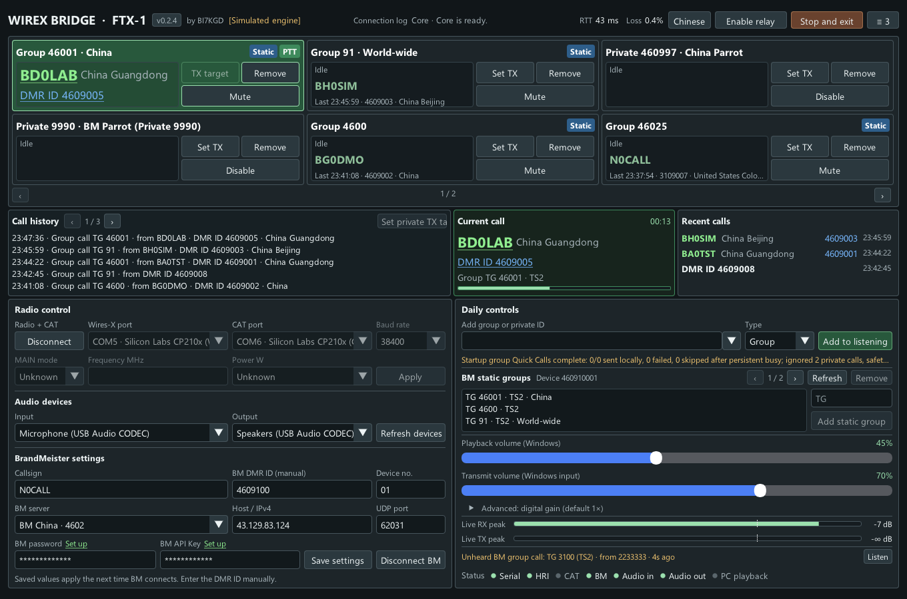
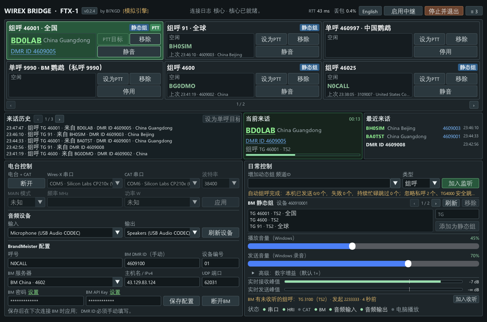

# WIREX Bridge

**English** · [中文](#中文)

WIREX Bridge connects a Yaesu FTX-1 in HRI mode to the BrandMeister DMR network. It is an experimental Windows application, tested on the FTX-1 only.

## Screenshots

Offline demo screenshots:

| English | 中文 |
| --- | --- |
|  |  |

## Features

- HRI Direct and Access Point modes, with automatic reconnect.
- CAT control for frequency, mode, and transmit power.
- BrandMeister talkgroups, static-group management, and caller details.
- Radio microphone PTT and two-way digital voice audio.
- Private-call parrot channels for China (`460997`) and BrandMeister (`9990`).
- Experimental FM relay.

## Quick start

1. Connect the FTX-1 by USB, enable HRI, and enter WIRES-X Direct or Access Point mode.
2. Start `WirexBridge.exe`. Select the radio ports and USB audio devices if they are not detected automatically.
3. Enter your callsign, DMR ID, hotspot password, and BrandMeister master. An API key is only needed for static-group management.
4. Connect the radio and BrandMeister. Select a channel; the microphone PTT sends to the selected destination.

The included BM Parrot channel is **Private 9990**. Select it to make an audio echo test.

## Compatibility and safety

- Windows 10 (1703 or later) / Windows 11, x64.
- Hardware verification has been done on the Yaesu FTX-1 only; other radio models are untested.
- `config.json` stores credentials locally as plain text. Keep it private.
- FM relay is experimental and is not an official Yaesu feature.
- The Android project is an early development build and does not yet provide radio, BrandMeister, or audio operation.

The embedded BrandMeister server list follows the [Pi-Star MMDVM host list](https://www.pistar.uk/downloads/DMR_Hosts.txt) (checked 19 Nov 2026).

Feedback, bug reports, and compatibility results are welcome: [open a GitHub Issue](https://github.com/iCassius/WIREX_Bridge/issues).

## License

GPL-3.0-or-later. See [LICENSE](LICENSE).

---

**中文** · [English](#wirex-bridge)

WIREX Bridge 是一款 Windows 实验软件，可将开启 HRI 的 Yaesu FTX-1 接入 BrandMeister DMR 网络。目前仅在 FTX-1 上进行了实机验证。

### 功能

- 支持 HRI Direct 与 Access Point 模式，掉线后自动重连。
- 通过 CAT 控制频率、模式和发射功率。
- 收听 BrandMeister 通话组、管理静态组并显示来话身份。
- 使用电台手咪 PTT 收发数字语音。
- 默认提供中国鹦鹉私呼 `460997` 和 BrandMeister 鹦鹉私呼 `9990`。
- FM 中继为实验功能。

### 快速开始

1. 用 USB 连接 FTX-1，开启 HRI，并进入 WIRES-X Direct 或 Access Point 模式。
2. 启动 `WirexBridge.exe`；如未自动识别，请选择电台串口和 USB 音频设备。
3. 填写本人呼号、DMR ID、热点密码并选择 BrandMeister Master。管理静态组时才需要 API Key。
4. 分别连接电台和 BrandMeister，选择频道后按手咪 PTT 发射。

BrandMeister 鹦鹉为**私呼 9990**，可用于语音回放测试。

### 兼容与安全

- 支持 Windows 10（1703 及以上）/ Windows 11 x64。
- 目前仅在 Yaesu FTX-1 上进行实机验证，其他型号尚未验证。
- `config.json` 在本地明文保存凭据，请妥善保管。
- FM 中继为实验功能，并非 Yaesu 官方功能。
- Android 工程处于早期开发阶段，尚不能连接电台、BrandMeister 或音频。

内置 BrandMeister 服务器列表参考 [Pi-Star MMDVM 主机列表](https://www.pistar.uk/downloads/DMR_Hosts.txt)，于 2026-11-19 核对。

欢迎反馈、提交问题和兼容性测试结果：[GitHub Issues](https://github.com/iCassius/WIREX_Bridge/issues)。

### 许可协议

GPL-3.0-or-later，详见 [LICENSE](LICENSE)。
